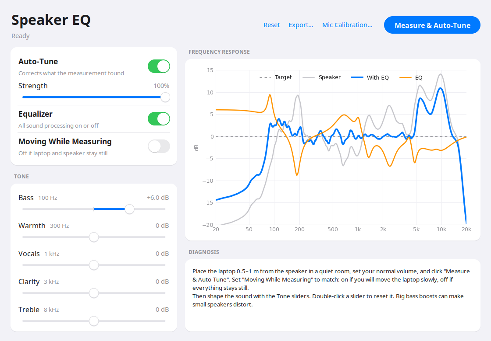

# Speaker EQ

Speaker EQ automatically tunes a speaker, such as a cheap Bluetooth speaker, using your laptop's microphone.
It plays a test sweep, works out what is wrong with the sound (boomy bass, harsh treble, room peaks,
distortion), and applies a correcting EQ to everything your computer plays. Simple tone sliders on top let
you adjust the sound to your taste.



## Features

- **One-click auto-tune:** measure, diagnose and correct in about a minute.
- **Plain-language diagnosis:** for example, "peak +9.9 dB at 190 Hz (bass: boomy)" or "Bass rolls off below 84 Hz".
- **Tone sliders:** Bass, Warmth, Vocals, Clarity and Treble, applied on top of the auto-tune.
- **On/off switches:** turn the auto-tune or the whole EQ off to compare by ear.
- **Loudness matched:** switching the EQ on doesn't make the sound quieter, and a limiter prevents clipping.
- **Two measurement modes:** *Moving* averages a listening area. *Still* (laptop and speaker can't move) uses
  gentler, position-safe bass correction.
- **Safe by design:**
  - No boost below the speaker's bass limit.
  - No boost where the speaker already distorts.
  - Treble changes limited when the mic isn't calibrated.
  - The mic level is set automatically.
- **Export** to Equalizer APO / AutoEQ format for Windows (Equalizer APO, Peace) and Android (Wavelet).

## Platforms

| Platform | How |
|---|---|
| **Linux** | Full app; the EQ runs through EasyEffects. `.deb` package or run from source |
| **Windows 10/11** | Full app (`SpeakerEQ.exe`); the EQ runs through Equalizer APO |
| **Android** | Measure on a computer, **Export…**, then import into Wavelet (see [Android](#android)) |

## Requirements (Linux)

- Linux with **PipeWire** (Ubuntu 22.10+, Fedora 34+, and most current distributions)
- **EasyEffects**, which applies the EQ to all audio
- Python 3.10+ with numpy, scipy, matplotlib, tkinter and Pillow
- A microphone (the laptop's built-in mic works; a calibrated USB mic is better, see [Accuracy](#accuracy))

## Install

### Option 1: .deb package (Ubuntu / Debian)

Download `speaker-eq_1.0.0_all.deb` from the releases page, or build it yourself (see [Development](#development)). Then:

```
sudo apt install ./speaker-eq_1.0.0_all.deb
```

apt installs all dependencies. To remove it: `sudo apt remove speaker-eq`.

### Option 2: run from the source folder

```
sudo apt install python3-numpy python3-scipy python3-matplotlib python3-tk python3-pil.imagetk \
                 pipewire-bin wireplumber easyeffects
./install.sh              # adds "Speaker EQ" to the apps menu and the speaker-eq / speaker-eq-gui commands
./install.sh --uninstall  # removes them
```

### Windows

1. Install **Equalizer APO** (free): https://sourceforge.net/projects/equalizerapo/
   - In its **Configurator**, tick your speaker (for example "Speakers (K68)") and restart Windows when it asks.
   - Optional: in `C:\Program Files\EqualizerAPO\config\config.txt`, remove the demo lines
     (`Include: example.txt` and its filters) so only Speaker EQ shapes the sound.
2. Download **SpeakerEQ.exe** from the releases page and run it. No installation is needed.
3. The first time the EQ is applied, Windows asks for permission **once**. Speaker EQ then creates its own
   `SpeakerEQ.txt` in Equalizer APO's folder and includes it from `config.txt`.

On Windows, mic-level problems are reported instead of fixed automatically: if a measurement clips, lower
the microphone level in **Settings → System → Sound → Input**. Equalizer APO has no limiter, so the EQ
lowers the volume by its largest boost to stay clip-free. Turn the speaker up to compensate.

### Android

Android has no system-wide EasyEffects or Equalizer APO, so you tune on a computer and use the result on
the phone:

1. Measure your speaker with Speaker EQ on Linux or Windows, then adjust the sliders.
2. Click **Export…** and save `SpeakerEQ_APO.txt`.
3. Copy the file to your phone and install **Wavelet** (Google Play).
4. In Wavelet, open **AutoEq → Import** and choose the file. Enable Wavelet for your Bluetooth speaker.

The file uses the standard Equalizer APO / AutoEQ format, so other apps that import AutoEq parametric
profiles (for example Poweramp Equalizer) work too.

## Usage

1. Connect your speaker and make it the **default output** (system sound settings).
2. Open **Speaker EQ** from the apps menu, or run `speaker-eq-gui`.
3. Set **Moving While Measuring**:
   - **Off:** the laptop and speaker stay completely still.
   - **On:** you'll move the laptop slowly while it measures. See [How to move](#how-to-move-the-laptop).
4. Set the volume you normally listen at, keep the room quiet, and click **Measure & Auto-Tune**.
5. Read the **Diagnosis**, then adjust to taste:
   - **Strength:** how much of the automatic correction to apply.
   - **Tone sliders:** drag, use the mouse wheel, or double-click to reset.
   - **Auto-Tune / Equalizer switches:** compare with and without the EQ.

Your settings are saved automatically and applied every time the app starts.

### How to move the laptop

Move it within an area about 30–60 cm across around where your head is when you listen:

- **Range:** about 20–30 cm left/right and forward/back, plus a little up and down around ear height.
- **Speed:** slowly, about 10 cm per second, in a figure-8 or circle the whole time.
- **Distance:** about the same distance from the speaker, at least 0.5 m away.
- **Mic:** keep the mic side facing the speaker, and don't cover it or bump the laptop.

### Command line

```
speaker-eq                  # measure (5 positions, prompts between them), write ParametricEQ.txt + response.png
speaker-eq --walk           # no prompts; keep moving the mic
speaker-eq --fixed          # mic and speaker stay still
speaker-eq --mic-cal FILE   # use a microphone calibration file
speaker-eq --selftest       # offline check of the whole pipeline
speaker-eq --help           # all options (target tilt, max boost, number of filters...)
```

## How it works

| Step | Method |
|---|---|
| Noise floor | Records silence first. Frequencies the mic can't hear clearly above the noise aren't EQed |
| Mic level | Lowers the input volume automatically if the mic saturates or a sweep clips, and restores yours afterwards |
| Measurement | Exponential sine sweep, 20 Hz–20 kHz (Farina). Bluetooth latency is found automatically |
| Response | Deconvolution → impulse response → windowing → frequency-dependent smoothing |
| Distortion | Harmonic distortion read from the same sweep. No boosts where it exceeds 3% |
| Speaker DSP | A second, quieter sweep shows whether the speaker changes its tone with volume |
| Usable range | Finds the speaker's real bass and treble limits and doesn't EQ outside them |
| Target | Flat with a gentle −0.8 dB/octave in-room tilt (Harman research) |
| EQ fit | Ideal correction → up to 10 parametric filters by bounded least-squares, cutting freely and boosting carefully |
| Playback | EasyEffects equalizer (same filter math), loudness-matched, with a −1 dBFS limiter |

### Research behind it

| Solution | Idea used here |
|---|---|
| Sonos Trueplay | Noise screening, frequency-dependent smoothing, power averaging, partial correction of room peaks, boost caps, ideal curve → parametric EQ fit |
| Dirac Live / Audyssey | Averaging several mic positions. Detecting volume-dependent processing (Dynamic EQ) |
| REW (Room EQ Wizard) | No EQ outside the frequency range the speaker can play. Limited boosts |
| AutoEQ | Bounded least-squares parametric EQ optimizer, about 10 filters |
| Farina's exponential sweep | Linear response and distortion from one sweep |
| Harman in-room research | Downward-sloping target curve |

## Accuracy

- **The microphone is the main limit.** Laptop and phone mics aren't flat, especially above 5 kHz. Without a
  calibration file, treble changes are limited to ±3 dB. A calibrated USB mic such as the miniDSP UMIK-1 or
  Dayton iMM-6 (with its calibration file, loaded via **Mic Calibration…**) makes the whole range trustworthy.
- The EQ is right for the volume you measured at, because many Bluetooth speakers change their tone with
  volume. The diagnosis warns you when yours does.
- The EQ only applies to audio played **by this computer**.
- EQ can't add bass a small speaker physically can't produce, and it won't push the speaker into distortion.

## Troubleshooting

| Problem | Fix |
|---|---|
| "Default output is … not a Bluetooth speaker" | Make the speaker the default output in sound settings |
| "Microphone records noise/garbage" | Check the input device in sound settings. Turn off mic noise suppression |
| "Recording too quiet" | Turn the speaker up, and check the speaker and mic are the default devices |
| No change when moving sliders | Make sure the **Equalizer** switch is on and that EasyEffects is installed |
| Other EasyEffects effects disappeared | Speaker EQ loads its own EasyEffects preset (`SpeakerEQ`) and replaces the current output effects |

## Development

```
python3 -m pytest tests         # 8 tests: pipeline, export, devices, GUI, mouse events, still mode, Windows paths
./packaging/build-deb.sh        # builds dist/speaker-eq_<version>_all.deb
```

GitHub Actions (`.github/workflows/build.yml`) runs the tests on Linux and Windows. It builds the `.deb`
and `SpeakerEQ.exe` (PyInstaller) and smoke-tests the exe. Pushing a tag like `v1.0.0` publishes both
files as a GitHub release.

| File | Purpose |
|---|---|
| `speaker_eq.py` | Measurement, analysis, diagnosis, EQ fitting, command line |
| `speaker_eq_gui.py` | Desktop app and EasyEffects integration |
| `install.sh` | Per-user install from the source folder |
| `packaging/build-deb.sh` | Debian package build |
| `.github/workflows/build.yml` | CI: tests, .deb and Windows .exe builds, releases |
| `tests/` | pytest suite |

User data (settings and last measurement) lives in `~/.local/share/speaker-eq/` (Windows: `%APPDATA%\speaker-eq`).

## Sources

- Sonos tech blog, Trueplay spectral correction: https://tech-blog.sonos.com/posts/trueplay-spectral-correction/
- Dirac Live: https://www.dirac.com/live/rc/ and https://www.audioholics.com/room-acoustics/dirac-room-correction-interview
- Audyssey: https://www.audioholics.com/room-acoustics/audyssey-room-eq-interview
- REW: https://www.roomeqwizard.com/help/help/html/eqsettings.html
- AutoEQ: https://github.com/jaakkopasanen/AutoEq
- Phone-mic calibration (EasyEyes): https://arxiv.org/pdf/2510.25048
- A. Farina, "Simultaneous measurement of impulse response and distortion with a swept-sine technique", AES 2000
